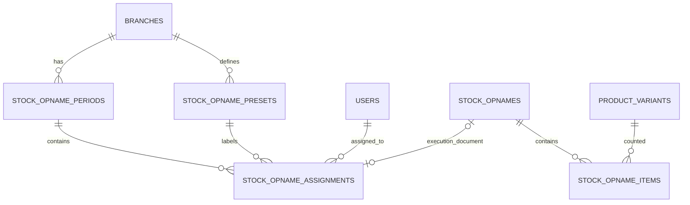

# Technical Design: Monthly Stock Opname Workflow

Status: Proposal for review  
Scope: Extend the existing Stock Opname workflow without replacing the current stock adjustment engine.

## 1. Current implementation

The existing implementation uses:

- `stock_opnames`: one stock-opname document, with branch, document number, date, `draft|completed` status, and notes.
- `stock_opname_items`: product variant, system quantity, physical quantity, difference, and cost price.
- `CreateStockOpname` / `UpdateStockOpname`: create/update draft items and calculate quantities.
- `ProcessStockOpnameComplete`: updates `product_branch_stocks`, creates stock movements, and posts a journal entry when differences exist.
- Filament `StockOpnameResource`: current backoffice UI for direct SO creation and completion.

The existing completion action is financially consequential. Worker submission must not call it. It should only run after an authorized review/finalization step.

## 2. Proposed domain model

Keep `stock_opnames` and `stock_opname_items` as the execution/result document. Add a monthly parent, reusable location presets, and assignments.

### A. `stock_opname_periods` — monthly parent

Suggested columns:

- `id`
- `branch_id` FK -> `branches.id` (restrict delete)
- `period` date (store first day of month, e.g. 2026-10-01)
- `name` (e.g. "SO Oktober 2026")
- `status` string/enum: `draft`, `active`, `review`, `completed`, `cancelled`
- `notes` nullable
- `created_by` nullable FK -> `users.id`
- timestamps

Constraints/indexes:
- Unique (`branch_id`, `period`) to prevent duplicate monthly SOs per branch.
- Index (`branch_id`, `status`).

### B. `stock_opname_presets` — reusable location labels

Suggested columns:

- `id`
- `branch_id` FK -> `branches.id` (preset is scoped to a branch)
- `name` (e.g. "Lantai 1")
- `description` nullable
- `is_active` boolean default true
- timestamps

Constraints/indexes:
- Unique (`branch_id`, normalized name) if database support/normalization policy allows; otherwise enforce case-insensitive duplicate validation in application.
- Index (`branch_id`, `is_active`).

Presets are labels for physical work areas only. They do not map to product categories and do not automatically filter products. Product records do not need a physical-location field for this scope.

### C. `stock_opname_assignments` — monthly work assignment

Suggested columns:

- `id`
- `stock_opname_period_id` FK -> `stock_opname_periods.id`
- `stock_opname_preset_id` FK -> `stock_opname_presets.id`
- `assigned_user_id` FK -> `users.id`
- `stock_opname_id` nullable FK -> `stock_opnames.id` (execution document created when work starts)
- `status` string/enum: `assigned`, `in_progress`, `submitted`, `needs_revision`, `completed`, `cancelled`
- `assigned_by` nullable FK -> `users.id`
- `assigned_at`, `started_at`, `submitted_at`, `reviewed_at` nullable timestamps
- `reviewed_by` nullable FK -> `users.id`
- `review_notes` nullable text
- timestamps

Constraints/indexes:
- Unique (`stock_opname_period_id`, `stock_opname_preset_id`) for the initial one-assignee-per-area rule.
- Index (`assigned_user_id`, `status`).
- Index (`stock_opname_period_id`, `status`).

This permits manual employee rotation between months while preserving assignment history. If the owner later needs multiple workers per area, the unique constraint can be reconsidered.

## 3. Relationship diagram

## 4. Workflow and status rules

1. Owner creates a period for a branch and month. It starts as `draft`.
2. Owner adds assignments by choosing a reusable location preset and employee.
3. Owner activates the period; assignments become visible to the assigned employees.
4. Employee starts a task. The application creates or resumes its `stock_opnames` draft and links it to the assignment.
5. Employee searches products by product name, variant name, SKU, or category; adds each variant once; enters physical quantity.
6. Employee submits the assignment. Assignment status becomes `submitted`; the stock-opname document remains `draft`. No stock movement or journal is created.
7. Owner reviews the submitted items and may request revision. Revisions reopen the draft only for the assigned employee and authorized reviewers.
8. Authorized owner/admin finalizes the accepted SO by invoking the existing `ProcessStockOpnameComplete` exactly once. Assignment becomes `completed`.
9. Period becomes `completed` only when all non-cancelled assignments are completed and no review/revision work remains.

The parent period status should be derived/reconciled from its assignments or changed through a centralized domain action; avoid allowing arbitrary UI edits to put it into an inconsistent state.

## 5. Progress calculation

Do not store a manually editable percentage.

Initial definition:
- `counted_items`: number of distinct item rows with an explicitly recorded physical quantity.
- `total_items`: number of distinct item rows included in the execution document.
- `progress_percent`: 0 when total is 0; otherwise rounded counted/total * 100.

Important limitation: because products are not assigned to physical locations, this progress measures the items entered into the task, not all physical products expected to exist in that area. The UI must not imply that a 100% value proves the entire area was exhaustively counted. A task can be marked submitted only when it has at least one item and passes server validation.

If a true expected total per location is required later, that needs an explicit product-to-location mapping or a predefined expected-item list; it is out of scope now.

## 6. Product search

- Support product name, variant name, SKU, and product category.
- Use server-side search with a sensible result limit/pagination; do not fetch every matching variant into memory.
- Group search conditions so `OR` clauses cannot bypass branch or active-product filters.
- Exclude service products and other non-stock-managed types from SO if consistent with the existing inventory rules.
- Enforce uniqueness of `product_variant_id` within one SO on the server; the UI should update/select the existing row rather than add duplicates.
- Continue sourcing branch stock from `product_branch_stocks` for the selected branch.

## 7. Finalization and inventory safety

Before calling the existing completion action:

- Verify actor authorization, assignment ownership, branch consistency, period status, and assignment status.
- Verify the SO is still draft and has not already been finalized.
- Reconcile/validate stock snapshot policy. Existing SO items store a system quantity at creation; do not silently overwrite that snapshot during review.
- Execute stock update, stock movements, journal creation, SO completion, and assignment completion transactionally.
- Ensure retries cannot create duplicate movements or journal entries. Add an explicit idempotency guard or unique reference constraints after checking current database constraints and existing accounting conventions.
- Keep legacy backoffice SO documents functional; do not change their behavior without a regression test.

## 8. Authorization

- Owner/admin roles can manage periods, presets, assignments, review, and finalization, subject to branch rules.
- Employees can list only their own assignments and access only the linked SO execution document.
- Every read/write endpoint and Livewire action must validate authorization server-side; hiding buttons is not authorization.
- A user's active branch must not allow accessing an assignment belonging to a different branch.

## 9. Implementation sequence

1. Add migrations and models/relationships for period, preset, and assignment.
2. Add feature tests for uniqueness, branch scoping, and assignment authorization.
3. Add backoffice CRUD for location presets.
4. Add monthly period management and manual employee assignment.
5. Add employee task list and SO execution UI using existing item/action logic where safe.
6. Add product search by name, variant name, SKU, and category with server-side limits.
7. Add submit/revision/review workflow, keeping submission separate from inventory finalization.
8. Integrate finalization with existing completion action using transactional/idempotent safeguards.
9. Add monitoring widgets and parent-period status reconciliation.
10. Run focused SO tests, then the full regression suite.

## 10. Acceptance criteria

- One monthly period per branch is enforced.
- Location presets are reusable and do not alter product master data.
- Owner can manually assign and rotate employees by period.
- Employees only see and edit their own assigned tasks.
- Product search supports name, SKU, and category without unbounded result loading.
- A submitted task does not change inventory, create stock movements, or post journals.
- Review/revision works before finalization.
- Finalization changes inventory and posts accounting effects at most once.
- Owner can monitor each assignment and the overall period.
- Existing direct SO backoffice workflow continues to pass regression tests.
